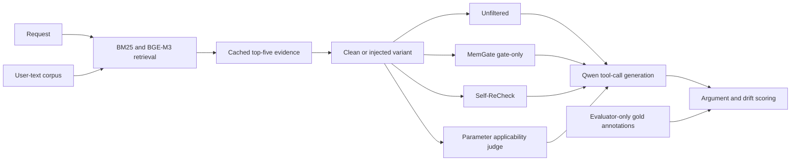

# Calibrated memory use in agentic tool calls

AI4015 Phase 2 · G1-17 · Muhammad Fatik Bin Imran · 23I-0655

This project evaluates whether irrelevant and partially relevant memories change tool arguments, and how memory defenses trade target-value uptake against grounding. It uses a local Qwen3-4B Q4_K_M model, the released Mem2ActBench data, query-only retrieval, and frozen paired inputs. Tool calls are generated and scored; external APIs are not executed.

## Architecture



The judge returns applicable/inapplicable/uncertain for every memory–parameter pair. Admitted memory is labeled with permitted fields in a shared generator prompt. This is an instruction-based restriction, not hard information isolation. Missing/invalid verdicts provide no evidence; incomplete Self-ReCheck responses use the recorded empty-context fallback.

## Results and gap resolution

Three greedy primary passes each contain 1,616 outcomes. All scored outcomes match across passes; one raw multi-call response differs. The 400-query retrieval baseline includes development tasks. The paired study has 100 held-out parents, 204 variants and four matched partial cases. Do not combine those populations as independent samples.

| Gap | Measurement | Result | Resolution |
|---|---|---|---|
| H1 | Clean versus unrelated injection, unfiltered | Uptake 1% to 22%; increase 21 points, paired 95% interval 13–29 | Supported in this local forced-exposure setting |
| H2 | Same injected tasks across defenses | MemGate uptake 24%, Self-ReCheck 4%, judge 15%; F1 17.58, 11.57, 16.90 versus unfiltered 19.22 | Mixed; predicted trade-off does not hold for every defense |
| H3 | Joint correctness under partial relevance | Zero joint successes in all arms on four cases | Unresolved; small, concentrated sample |

F1 above is on a 0–100 scale. Full-release BM25 F1 is 22.17 and hybrid F1 is 24.59. Removing judge scoping instructions increases unrelated uptake from 15% to 22%. Under natural hybrid retrieval, 17/100 unrelated and 0/4 partial injections enter the top five. These exposure counts are not downstream attack-success estimates. The released-wrapper check is a separate 13-query diagnostic.

[Experiment evidence index](research/experiment-evidence-index.md) · [Primary results](research/first-pass-findings.md) · [Repeatability metrics](results/primary-repeatability-summary.json) · [Ablation](research/scoping-ablation-findings.md)

## Install and obtain assets

Run commands from the repository root. Python 3.12 was used. Base dependencies are in requirements.txt; CPU embedding pins are in requirements-retrieval.txt and the full observed environment is research/evidence/retrieval-runtime-lock.txt. The measured Windows GPU build and library receipts are recorded under research/evidence. CPU installation alone does not reproduce the reported GPU timings.

```powershell
python -m pip install -r requirements.txt
python -m venv --system-site-packages data/runtime/retrieval
data/runtime/retrieval/Scripts/python.exe -m pip install -r requirements-retrieval.txt
git clone https://github.com/Cantaloupe-M/Mem2ActBench.git data/Mem2ActBench
git -C data/Mem2ActBench checkout --detach c935c65be9aa19c930b60657c0c4b2b7ea13a34a
python -m scripts.verify_benchmark_release
python -m scripts.download_model
```

The benchmark is not included in this repository. These commands fetch it from the official upstream repository and check out the pinned revision used by this study. Run them in a fresh project checkout; if `data/Mem2ActBench` already exists and is not an independent clone, preserve it and use a clean checkout rather than cloning over it. Public releases of this project include code and non-text aggregate evidence only: do not commit benchmark files, raw traces, task-level outputs, or prompts, memories, requests, and model responses copied from benchmark data. See the [release audit](research/retrieval-release-audit.md) for the publication protocol and provenance.

The generator is expected at models/Qwen_Qwen3-4B-Q4_K_M.gguf. Its original downloader selects a filename without a pinned upstream revision; compare the downloaded file with the recorded local asset checksum before claiming exact reproduction. The tokenizer/model asset is required for new inference and chunk preparation, but not for scoring saved traces.

For the measured Windows CUDA runtime, create data/runtime/generator-cuda with system site packages, install the official llama-cpp-python 0.3.36 cu124 Windows wheel specified in research/evidence/gpu-wheel-receipt.json, and install nvidia-cublas-cu12==12.4.5.8 and nvidia-cuda-runtime-cu12==12.4.127. The runners prepend those environments' NVIDIA bin paths automatically. Verify with scripts/check_gpu_runtime.py. Models and environments are excluded from the source archive.

No hosted API key is needed. .env.example documents relevant environment variables; scripts do not automatically load a .env file. Most evaluation settings are frozen in research/retrieval-budgets.json, design_decisions.md and research/evidence/model-revisions.json. Changing these invalidates checkpoint provenance.

## Reproduce saved scores

With base dependencies and the pinned dataset available:

```powershell
python -m scripts.score_approved_evaluation
python -m scripts.score_primary_repeat --repeat 2
python -m scripts.score_primary_repeat --repeat 3
python -m scripts.summarize_primary_repeats
python -m scripts.summarize_approved_pass
python -m scripts.analyze_first_pass_failures
python -m scripts.score_scoping_ablation
python -m scripts.score_memgate_wrapper
python -m unittest discover -s tests -v
```

Scoring verifies the complete expected workload. Re-running a scorer rewrites its derived summary from preserved raw traces. E1/E2 are the two baseline panels; E3/E4 are the four-arm paired panels; E5 is the scoped-instruction ablation plus existing unfiltered comparison; E6 uses saved timing, token and failure records. The E2 experiment is a documented local reimplementation, not an exact reproduction of a published paper-table manifest.

## Rebuild retrieval and run inference

```powershell
python -m scripts.prepare_retrieval_candidates
data/runtime/retrieval/Scripts/python.exe -m scripts.embed_retrieval_candidates --download-only
data/runtime/retrieval/Scripts/python.exe -m scripts.embed_retrieval_candidates --offline --batch-size 32 --threads 8
data/runtime/retrieval/Scripts/python.exe -m scripts.rank_full_release
python -m scripts.prepare_approved_evaluation
data/runtime/retrieval/Scripts/python.exe -m scripts.probe_memgate_runtime --development data/retrieval-dev/eval-paired.json
data/runtime/generator-cuda/Scripts/python.exe -m scripts.run_comparative_development --approved-evaluation
```

Generation resumes existing checkpoints; it does not create a fresh pass merely by being invoked again. The completed repeat directories likewise resume their own passes. Use a separate extracted working copy with the relevant output checkpoint directories absent to rerun fresh inference while preserving the original evidence. Do not delete the only copy of recorded results.

Supplemental generation commands are scripts/run_scoping_ablation.py and scripts/check_memgate_wrapper.py (prepare in the retrieval environment, then run in the GPU environment). Natural-retrieval sensitivity runs with the retrieval environment via scripts/check_natural_retrieval.py. These scripts preserve hashes and reject incompatible resumes. See their corresponding findings documents for exact sequences and limitations.

## Changes since Phase 1

Phase 1 used annotated source-linked histories and is retained as historical oracle-style context. Phase 2 introduces query-only corpus retrieval, source/query-grouped development separation, prospective enrollment and human review, the approved 100-parent sample, GPU generation, a development-approved /no_think suffix, defensive filtering, fixed literal scoring, paired uncertainty, ablation and three-pass repeatability. The historical Phase 1 F1 is not a comparable improvement baseline.

## Repository organization and limits

src/ contains retrieval, prompt, parser and scoring components; scripts/ contains reproducible experiment entry points; results/ contains local raw traces and derived statistics, while public releases include only non-text aggregate evidence; research/evidence/ contains frozen manifests and review records. research/devlog.md records changes and measured effects. Operator-facing notes are separate files, not part of research findings. docs/ is operator-owned and excluded from packaging.

The study uses one quantized local model and synthetic injections. Literal scoring can penalize equivalent representations; the parser evaluates only the first call. Partial-relevance evidence is sparse. Eight later synthetic feasibility candidates received construction review (three Accept, two Revise, three Hold) but were not evaluated and do not enlarge the H3 result. No claim of general defense superiority or proven publishability is made.
