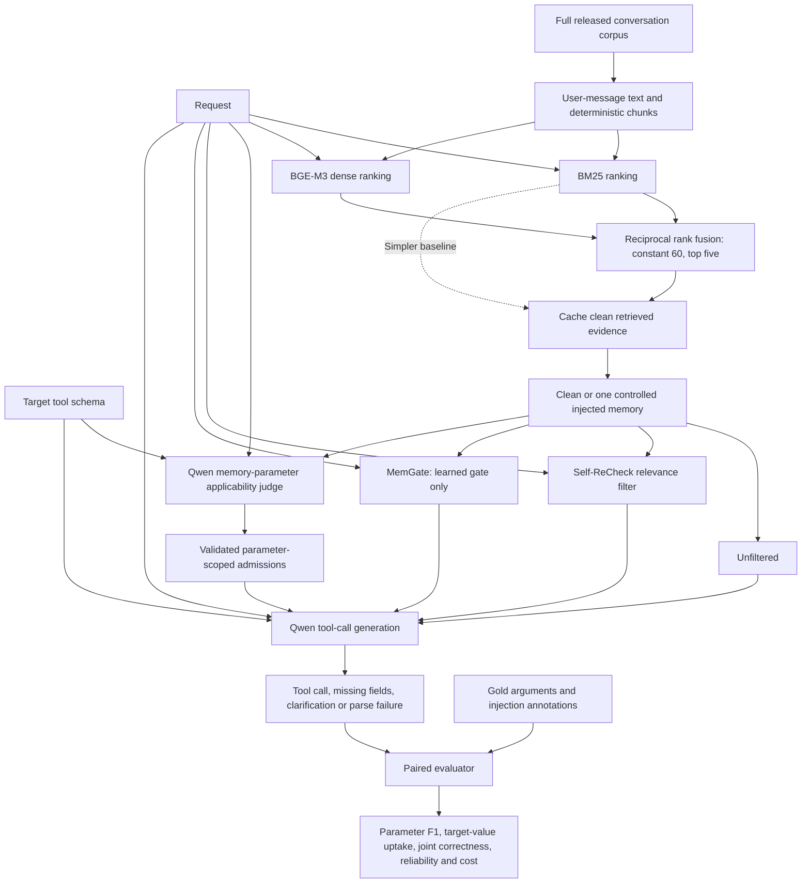

# Research workflow architecture

This diagram represents the approved comparison design. The evaluation uses 128-token chunks and a 4,096-token context. The historical source-linked Phase 1 loader is a separate development condition and does not supply evidence to the retrieval experiment.

The clean and injected variants reuse retrieved evidence. The controlled memory is supplied before every defense. Gold arguments, source-link annotations and injected-target labels are evaluator inputs; they are excluded from the judge and generator prompts. Provenance remains in saved traces. Prompt-capacity checks must reject overflow rather than silently change evidence across conditions.

MemGate retains its published checkpoint, encoder and threshold 0.07. The main comparator disables checkpoint-restored guidance messages, as explicitly approved. A separate check uses the full released wrapper on the 13 affected queries. A small natural-retrieval injection check remains separate from the main conditional-on-exposure experiment.

## Implementation status

| Component | Current implementation |
|---|---|
| Chunking, BM25, dense-vector ranking and RRF | `src/data/retrieval.py` |
| Completed-cache verification | `src/data/embedding_cache.py` |
| Shared prompts, parameter-scoped rendering, response schema and capacity guard | `src/agent/memory_prompts.py` |
| Approved gate-only MemGate adapter | `src/agent/memgate_adapter.py` |
| Development retrieval and prompt measurements | `scripts/check_hybrid_development.py` |
| Released MemGate example and development scoring | `scripts/probe_memgate_runtime.py` |
| Full comparative generation runner | Integration and development validation pending |

The diagram is not evidence that all comparisons have run. Development measurements, implementation checks and research outcomes are recorded separately.
